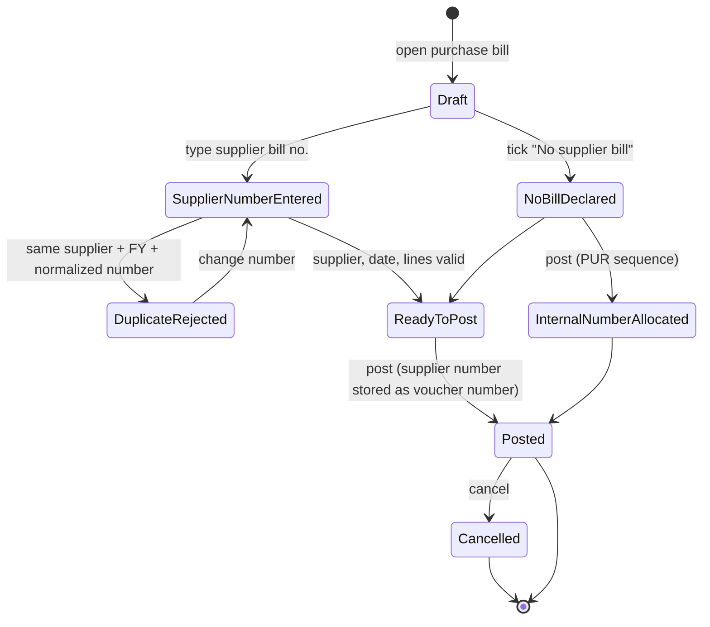

# 20 — Supplier bill numbering

Status: implemented. Decision: [ADR 0001](./adr/0001-supplier-bill-numbering.md).
Read with: [`04-tax-rounding-and-numbering.md`](./04-tax-rounding-and-numbering.md)
§4, [`17-invoice-print.md`](./17-invoice-print.md).

A purchase bill is the supplier's tax invoice. Its identity is the number the
supplier printed, so that number becomes `vouchers.number`. GSTR-2B
reconciliation, supplier follow-up and duplicate detection all match on it. A
purchase the supplier did not invoice still needs a number, so it takes the
internal `PUR` sequence.

## State machine



## Data model

Migration `0005_supplier_bill_numbers.sql` adds:

```
vouchers.number_source      text not null default 'INTERNAL'
                            check (number_source in ('INTERNAL', 'SUPPLIER'))
vouchers.number_normalized  text    -- null for internal numbering
```

Existing rows are backfilled as `INTERNAL`. `number` keeps the typed value;
`number_normalized` is only a comparison key.

## Rules

1. On `PURCHASE`, exactly one of `supplierBillNo` and `supplierBillMissing` is
   required.
2. A supplier number is trimmed, 1–32 characters, and rejects control
   characters. It is stored and printed exactly as typed.
3. Normalization for duplicate detection is uppercase with spaces, `/`, `-` and
   `.` removed. `tc 2026-27.583` and `TC/2026-27/583` are the same bill.
4. A duplicate is scoped to company, supplier and financial year, and excludes
   `CANCELLED` vouchers. It returns `DUPLICATE_SUPPLIER_BILL` naming the
   existing voucher number and date.
5. The financial year comes from the voucher date and
   `companies.fy_start_month`.
6. Supplier-numbered purchases skip `numbering::allocate_number` and store
   `number_source = 'SUPPLIER'`.
7. A declared no-bill purchase allocates the next `PUR` number and stores
   `number_source = 'INTERNAL'`.
8. Supplier fields on any other voucher type are rejected.
9. Sales invoices and every other voucher type keep their internal sequence.

## Series scoping (why there is no partial index)

The vouchers table already carries a table-level
`UNIQUE (company_id, voucher_type, series, fy, number)`. SQLite cannot drop a
constraint, and rebuilding the table to add a partial index is not worth the
risk for this feature.

Instead a supplier-numbered purchase uses `series = 'SUP' || party_id`, for
example `SUP42`. The series is internal and never printed. The existing
constraint then enforces `(company, supplier, fy, number)`, while two suppliers
may use the same number. A later financial year gets a new `fy`, so reuse there
is allowed as GST Rule 46(b) expects.

`numbering::allocate_number` never touches these series: supplier-numbered
purchases bypass it. `voucher_sequences` therefore keeps a normal `PUR`
sequence for no-bill purchases.

## Cancellation

`repo::cancel` sets `status = 'CANCELLED'` and, when
`number_source = 'SUPPLIER'`, appends `/C<id>` to `series` in the same UPDATE.
`number` stays untouched. The unique slot in the live `SUP<party_id>` series is
freed, so the same supplier bill can be entered again. Because the cancelled row
has a different series, the table constraint no longer collides, and the
duplicate query skips `CANCELLED` rows anyway. The suffix also makes the
cancellation visible in the stored series without changing the printed number.

## Entry form

`VoucherEntryPage`, purchase only:

- "Supplier bill no." is in step 1, required, focused after the supplier is
  chosen.
- The header chip shows the typed number instead of the static `PUR` chip once
  a number is entered.
- "No supplier bill" disables the field, clears it, and explains the `PUR`
  fallback in one sentence.
- `DUPLICATE_SUPPLIER_BILL` renders inline on the field, with `aria-invalid` and
  the existing voucher's number and date from the server message.

The form submits `supplierBillNo` and `supplierBillMissing`. Other voucher
screens send neither.

## Print

`vouchers:invoice` exposes `numberSource`. Both pipelines use it:

| number_source | Supplier Bill No. | Voucher No. |
| --- | --- | --- |
| `SUPPLIER` | `vouchers.number` | `vouchers.number` |
| `INTERNAL` | `—` | `vouchers.number` (`PUR/…`) |

`referenceNo` prints as **Reference No. & Date** on the purchase grid. It is
the order reference only; it never substitutes for the document number.

Both producers read `src/shared/print-geometry.json`; this change does not add
any hardcoded width.

## Tests

- `src-tauri/src/numbering/mod.rs` — normalization, 1–32 bounds, control
  characters, FY derivation.
- `src-tauri/src/vouchers/mod.rs` — exactly one purchase identity, purchase-only
  fields, bounded and printable numbers.
- `src-tauri/tests/rpc_flow.rs` — post a supplier bill, duplicate rejected with
  the existing number and date, same number for another supplier accepted, same
  number in a later FY accepted, cancel then re-post accepted, no-bill purchase
  gets `PUR`, print read model carries `numberSource`.
- `src-tauri/tests/full_flow.rs` — the older purchase flow declares a no-bill
  purchase and still gets `PUR/0001`.
- `tests/renderer/voucher-supplier-bill.test.tsx` — required field and focus
  order, header identity, checkbox behaviour and payload, inline duplicate.
- `tests/renderer/invoice-sheet.test.tsx` — supplier number on both purchase
  rows, em dash for an internal no-bill purchase.
- `src-tauri/src/export/invoice_pdf.rs` — the PDF model makes the same number
  decision.
