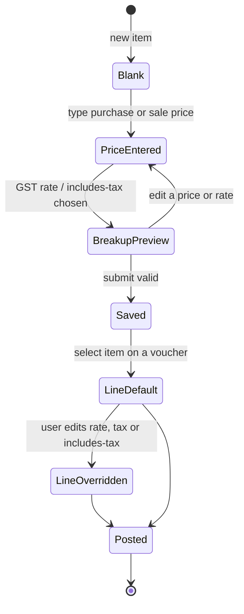

# 21 — Item price and tax breakup

Status: shipped
Issue: #27
Decision: `docs/adr/0002-item-price-tax-breakup.md`

## What shipped

An item now stores the price the user typed together with a flag saying whether
tax sits inside it. Nothing is converted on save.

| Column | Default | Meaning |
|---|---|---|
| `items.sale_price_includes_tax` | `1` | The sale price is the customer-facing gross; tax is extracted from it. |
| `items.purchase_price_includes_tax` | `0` | The purchase price is the supplier's base; tax is added to it. |

Both columns are `INTEGER NOT NULL CHECK (... IN (0,1))`. They arrived in
migration `0004_item_price_tax.sql`, the next free number after the unit-active
migration (the issue's `0005` placeholder was not used).

The item API now also exposes `cess_rate_bps`, which existed in the schema but
was unreachable from the form.

## Arithmetic

All money is integer paise and rates are basis points. Rounding is half away
from zero, matching `roundHalfUpDiv` in Rust and the voucher preview.

### Inclusive price → taxable, GST, cess

```
taxable = round(gross × 10_000 / (10_000 + gstBps + cessBps))
tax     = gross − taxable
cess    = round(taxable × cessBps / 10_000)
gst     = tax − cess
```

`2500` at 18% gives `2118.64` taxable and `381.36` GST. The parts always add
back to the typed gross.

### Exclusive price → GST, cess, gross

```
gst   = round(taxable × gstBps / 10_000)
cess  = round(taxable × cessBps / 10_000)
gross = taxable + gst + cess
```

`1750` at 18% gives `315` GST and a `2065` landed cost.

The single implementation lives in `src/shared/price.ts`
(`splitInclusivePrice`, `grossFromExclusive`). The form, list, detail page and
voucher preview call it. Posting already supported `rate_includes_tax` and cess;
this change adds tests for those paths rather than a second calculator.

## Where it shows

- **Item dialog** shows a live breakup under each price. The sale side has a
  **Price includes tax** checkbox. The purchase side always shows the landed
  cost. The GST picker keeps cess-bearing rows and labels them, for example
  `GST 18% + 12% cess`.
- **Item list** shows the sale gross and the landed purchase cost. Taxable value
  is the secondary line. Margin compares taxable sale with landed cost.
- **Item detail** uses the same gross/landed numbers and includes cess in the
  subtitle.
- **Voucher entry** fills the line rate from the item's typed price. Sales and
  credit notes inherit `salePriceIncludesTax`; purchases and debit notes start
  exclusive. Each line has an **Incl. tax** toggle that changes the preview's
  taxable/tax split and is submitted as `rateIncludesTax`. The preview also
  reads the selected item's cess rate, so its taxable, GST, cess and total agree
  with `compute_line_tax` on the server. Purchase lines always post
  tax-exclusive so input tax stays a separate ledger line.

## State machine



## Validation

- `items:create` / `items:update` accept booleans or the integer forms `0`/`1`
  for the two flags. Any other value is `VALIDATION_ERROR`.
- `cessRateBps` is `0..=5000`, the same ceiling as the GST rate.
- Existing rows migrate to sale inclusive `1`, purchase inclusive `0`.
- Posted vouchers are untouched: they already snapshot rate, tax and totals.

## Tests

- `src-tauri/src/masters/mod.rs`: flag reader accepts booleans and `0/1`,
  rejects `2`.
- `src-tauri/src/vouchers/posting.rs`: 2500 inclusive @18%, 1750 exclusive @18%,
  and an inclusive line with cess.
- `src-tauri/tests/rpc_flow.rs::item_price_tax_flow`: item create/update
  round-trip plus one inclusive sale and one exclusive purchase posting.
- `tests/shared/price.test.ts`: 2500 @18%, 1750 @18%, zero-rated and cess.
- `tests/renderer/item-dialog.test.tsx`: breakups, flag toggle, cess, payload.
- `tests/renderer/voucher-line-tax.test.tsx`: per-line toggle recalculates the
  preview.

## Deliberate limits

- One GST rate and one cess rate per item drive both directions of trade.
  Per-line overrides cover a one-off supplier rate.
- The item form only edits the sale flag. The purchase flag is stored and
  returned by the API, but purchase lines always post exclusive.
- No price history or date-effective price lists yet. A price edit affects
  future lines only.
- Cess posts only when the chart of accounts has `OUTPUT_CESS` / `INPUT_CESS`.
  The seeded chart is GST-only, so a cess-bearing item still previews cess but
  the seeded backend drops it. Adding those accounts enables the posting path.
