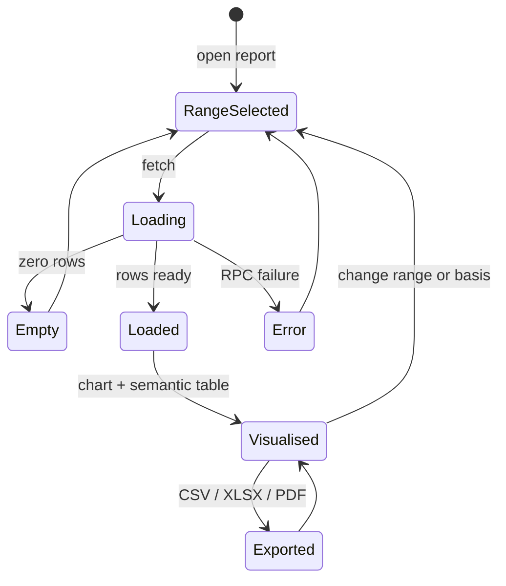

# Report visuals and semantic tables

Status: implemented (issue #29)
Read with: `05-reports-spec.md`, `06-design-system.md`, `src-tauri/src/reports/`

## 1. What changed

The report surface gained a visual layer and a semantic table while keeping one
source of truth: the RPC rows. Charts never compute their own numbers; they are
shaped from the same rows the table renders.

| Layer | File |
|---|---|
| Chart primitives | `src/renderer/src/components/charts/report-charts.tsx` |
| Palette | `src/renderer/src/components/charts/report-chart-palette.ts` |
| Shared legend and data table | `src/renderer/src/components/charts/chart-frame.tsx` |
| Chart selection per report | `src/renderer/src/features/reports/components/report-visuals.tsx` |
| Table | `src/renderer/src/features/reports/components/report-table.tsx` |
| Status and amount tones | `src/renderer/src/features/reports/report-status.ts` |
| Pure shaping | `src/renderer/src/features/reports/report-shaping.ts` |
| Page shell | `src/renderer/src/features/reports/pages/ReportsPage.tsx` |

## 2. State machine



The renderer follows the machine directly:

- `ReportsPage` owns `from`, `to` and `basis`. They are part of the TanStack
  Query key, so one state change refetches once and updates the KPI cards, the
  charts and the table together.
- `Loading` renders the loading plate, `Error` the inline destructive panel.
- `Loaded` renders `ReportStats`, then `ReportVisuals`, then `ReportBody`.
- `Empty` is decided by the report body; `ReportVisuals` returns `null` when the
  rows carry no money, so no chart appears without its fallback.
- Export is delegated to the table toolbar. It never asks the chart for data.

## 3. Chart map

| Report | Primary | Secondary | Chart-free |
|---|---|---|---|
| Receivables | Ageing bucket composition, horizontal stacked bar | Top 8 customers by overdue | |
| Payables | Ageing bucket composition, horizontal stacked bar | Top 8 suppliers due within 30 days | |
| Ageing | Buckets per party, horizontal stacked bars | | |
| Sales register | Monthly taxable value, area + GST line | CGST/SGST/IGST by month, stacked bars | |
| Purchase register | Monthly taxable purchases, area + input tax line | CGST/SGST/IGST by month, stacked bars | |
| Profit and loss | Income and expense areas + net profit line | Expense composition, horizontal bars | |
| Trial balance | Group totals table, no chart | | Yes |
| Balance sheet | Balance check with a status pill, no chart | | Yes |

Charts live inside `ChartCard`, which supplies the visible title and the
question the chart answers. `report-print-hide` wraps the chart grid, so print
and PDF show the table only.

## 4. Accessibility

- Every `Chart` receives `ariaLabel` and, where the title is not enough, an
  `ariaDescription` explaining units and the first bucket's meaning.
- `role="img"` and the chart roledescription come from TanStack Charts.
- Each chart follows with a `<details>` data table. The table has a
  screen-reader caption and `scope` on its header cells.
- Legends are text lists; colour is redundant.
- Status cells carry a word and an icon. Amount colour is redundant with the
  sign and the number itself.
- The table headers are real `th` with `scope="col"`; group headers are `th`
  with `colSpan`. Keyboard users reach the export buttons in the toolbar.

## 5. Data shaping

All shaping functions are pure, in `report-shaping.ts`, and unit tested in
`tests/shared/report-shaping.test.ts`. Money stays in integer minor units.

| Function | Use |
|---|---|
| `monthKeysBetween`, `monthLabel` | Continuous month axis without `Date` and timezone drift |
| `monthlyRegisterSeries` | Registers: taxable, tax, CGST/SGST/IGST and total per month, zero-filled |
| `bucketTotals`, `bucketSlices` | Receivables/payables: one composition bar from every party row |
| `ageingParties`, `ageingStackRows` | Ageing: top parties plus an `Other parties (n)` remainder that preserves totals |
| `taxSplitRows`, `hasTax` | Register tax split, and whether the second chart is worth drawing |
| `profitMonthlySeries` | P&L: expand the RPC series over the period |
| `expenseComposition` | P&L: ranked expense accounts plus an `Other expenses (n)` remainder |
| `rankedItems` | Top-N ranking, stable for ties |
| `openBalanceStatus`, `amountTone` | Table status and amount semantics |

Charts convert to major units only when handing values to `@tanstack/charts`;
the data table uses `formatMinor`.

## 6. RPC additions

Read-only, additive, no report tables.

### `reports:receivables` and `reports:payables`

Each party row now also carries:

```json
{
  "bucketsMinor": [1200, 0, 0, 0, 0],
  "dueWithin7Minor": 0,
  "dueWithin30Minor": 1200
}
```

`bucketsMinor` uses the same `splitBucket` rule as the ageing report: all bills,
including bills that are not due yet, land in 0-30. `dueWithin7Minor` and
`dueWithin30Minor` count bills due today or later, measured from the due date,
so they are independent of the `BILL_DATE`/`DUE_DATE` ageing basis.

### `reports:profitLoss`

The response now also carries `monthly`:

```json
"monthly": [
  { "month": "2026-04", "incomeMinor": 158000, "expenseMinor": 121000, "netProfitMinor": 37000 }
]
```

The SQL groups posted income and expense ledger lines by calendar month. The
P&L totals come from `period_balances`, which also folds account opening
balances in; those are not ledger lines, so the difference is added to the first
month. The series therefore reconciles exactly to the report totals. The
renderer fills months with no activity.

## 7. Table semantics

The table is neutral: no zebra stripes, horizontal rules only.

- Header: paper tint with the report accent as a top rule.
- Status: 3px left stripe plus a word and an icon. Overdue, due within seven
  days, current/settled and posted have distinct semantics; colour is never the
  only signal.
- Amounts: negative destructive, credit or settled success, zero muted.
- Totals: muted band, strong top rule, bold, no colour.
- Group rows: tinted band in P&L and the balance sheet.
- Export parity: group rows are not exported; every existing column, data row
  and total is unchanged.

## 8. Tests

| Test | Covers |
|---|---|
| `tests/shared/report-shaping.test.ts` | Every shaping function, empty and single-row cases, remainder folding, total reconciliation |
| `tests/renderer/report-charts.test.tsx` | Accessible name, legend, data table, horizontal composition, ranking |
| `tests/renderer/report-table.test.tsx` | Header accent, status stripe and label, amount tones, group rows, totals band, export excludes groups, empty state |
| `tests/renderer/report-visuals.test.tsx` | Chart-to-report map, chart-free trial balance and balance sheet, empty state |
| `tests/renderer/reports-page.test.tsx` | One query feeds chart and table, range change updates both, print surface preserved |
| `src-tauri/src/reports/mod.rs` tests | Bucket and due-soon grouping, monthly series with opening-balance folding |
| `src-tauri/tests/rpc_flow.rs` | Additive RPC fields and the monthly series in the end-to-end flow |

`tests/renderer/report-visuals-proof.test.tsx` is a proof generator, skipped in a
normal run. Set `REPORT_PROOF_DIR` to write one SVG per chart in light and dark
mode. The committed proofs are in `docs/e2e-screens/report-visuals/`, and the
two gallery screenshots (`report-visuals-light.png`, `report-visuals-dark.png`)
are renders of those SVGs.

## 9. Decisions

1. **Bucket charts are composition bars.** One horizontal stacked bar per
   report answers "how old is the outstanding balance" without inventing a
   second dimension. Ageing by party uses the same layers per party.
2. **Top-N charts are rankings.** They intentionally show a subset; the title
   says "Top 8". Bucket charts always include every row, or fold the remainder,
   so their totals equal the table.
3. **P&L opening balances fold into the first month.** This is the only way a
   ledger-line series can reconcile to a report whose totals include account
   opening balances.
4. **The table keeps one component.** Status and tones are metadata on a row,
   not a second table implementation, which keeps export parity in one place.
5. **Print stays monochrome.** The print stylesheet flattens cell borders, so
   the 3px status stripe does not print as colour.

## 10. Structural reports

The balance sheet and the trial balance answer a proof question, not a trend
question, so they stay chart-free.

- The balance sheet opens with a balance check: assets, liabilities and equity,
  and a status pill reading `Balanced` or `Out by <amount>`. The pill reads
  `differenceMinor` exactly, so a non-zero difference is visible before the
  account lists rather than only in the footer.
- The trial balance opens with a compact table of debit and credit per account
  group. The detail table below keeps every account and its proof footer, so the
  group summary and the account detail come from the same rows.
- Both additions are screen reads over the rows already fetched and carry
  `report-print-hide`, so the printed report and every export keep their existing
  rows, columns and totals.

`trialBalanceGroups` in `report-shaping.ts` owns the group totals. It drops
accounts with no movement and sorts by group name, so the summary lists the same
groups the detail table shows. `tests/shared/report-shaping.test.ts` covers the
sums and the zero-movement case. `tests/renderer/report-structure.test.tsx`
covers the balanced and out-of-balance pills and the group summary next to the
proof row.
