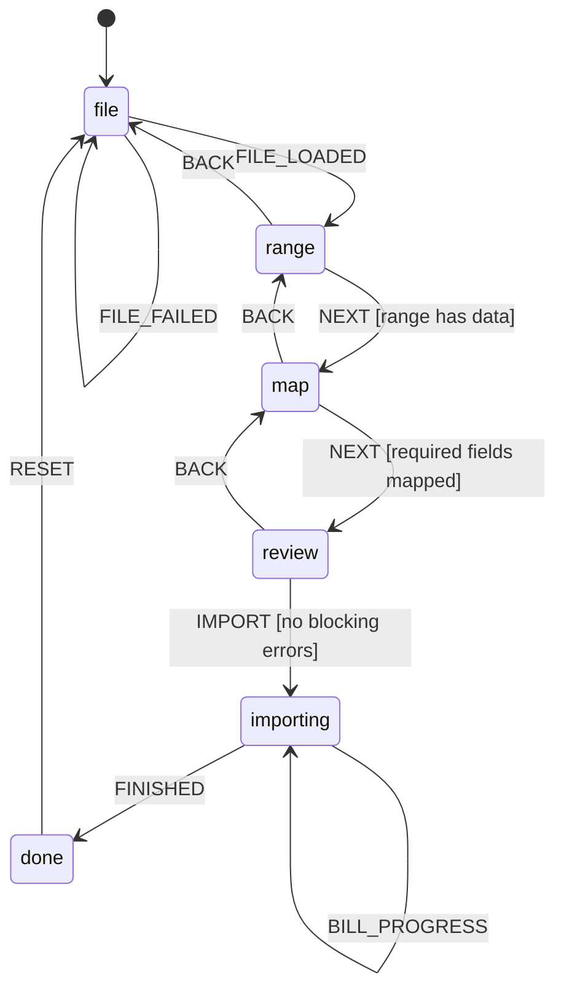

# Excel importer: user story, journey and statechart

Status: prototype, built for review
Read with: `01-domain-model.md`, `02-database-schema.md`, `06-design-system.md`,
`form-implementation-guideline.md`
User guide: `guides/importing-from-excel.md`

## 1. The job

A trader already keeps purchase and sales data in Excel. The file is theirs. It
has a title row, a merged header, a blank row, a total at the bottom, and maybe
three sheets from three different people. Asking them to reshape it into our
template is the failure mode. They will retype instead, or not migrate at all.

The importer accepts the sheet as it is:

1. Pick the sheet and drag over the cell range that holds the table.
2. Say which column is the bill number, the date, the party, the item, the
   quantity, the rate and the tax.
3. See every bill that will be created, every row that cannot be imported, and
   the exact reason.
4. Import real purchase bills or sales invoices, or stop with nothing written.

The file never leaves the machine. Nothing is posted until the user presses
Import.

## 2. User stories

### US-1: Bring in last year's purchase bills

Priya is the purchase clerk. Her supplier sends a monthly statement in Excel.
She needs the bills in Crown Books so payables and input tax are correct.

Acceptance:

- She can choose the file, the sheet, and the table range without editing the
  file.
- Columns are matched to supplier bill number, bill date, supplier, item, HSN,
  quantity, unit, rate, discount and GST.
- Rows with the same supplier bill number become one purchase bill with several
  item lines.
- A supplier that does not exist can be created during the import, or matched to
  an existing supplier.
- A duplicate supplier bill number is refused with the bill number and supplier
  named.
- She sees the total of every bill before importing.

### US-2: Bring in sales invoices from the old software

Rakesh exported his invoices from the previous billing software. He wants the
receivables and the sales register to start from the right place.

Acceptance:

- He can import sales invoices with the same range and mapping flow.
- The old invoice number is kept as the voucher reference, because Crown Books
  assigns its own sales series.
- A customer that does not exist can be created during the import.
- The posted invoice shows the same taxable value, tax split and total as the
  preview, to the paisa.

### US-3: Check the file before anything is written

Meera is the accountant. She does not trust an import she cannot inspect.

Acceptance:

- Every bill can be expanded to its lines, with the source Excel row number.
- Errors block the import and name the row, the column and the fix.
- Warnings do not block, and are counted separately.
- The import summary states how many bills, lines, parties and items will be
  created.
- Nothing is written when she leaves the page before Import.

### US-4: Recover from a partial failure

The database refuses one bill, for example a duplicate supplier bill. The other
bills are already posted.

Acceptance:

- Each bill shows its own result: posted with number, or failed with reason.
- Posted bills are not posted again on retry. The request key is stable.
- Failed bills can be retried after the cause is fixed.
- The result list links to each posted voucher.

### US-5: Know what to do without reading a manual

A first-time user opens the importer and has never imported anything.

Acceptance:

- The first screen offers a sample file, so the flow can be tried with no
  preparation.
- Each step says what it needs in one sentence, and why.
- The selected header row, mapping and totals are always visible, never hidden
  behind a tooltip.
- Every blocked action states the reason next to the button.
- A short guide is available in the page, and a longer guide is in `docs/guides`.

## 3. The journey

The user is not filling a form. They are walking a table from a file into the
books. Each stage has one question to answer.

| Stage              | The user's question                       | What the screen answers                                        | Exit                               |
| ------------------ | ----------------------------------------- | -------------------------------------------------------------- | ---------------------------------- |
| 0. Entry           | Where do I start?                         | Choose purchase or sales, then a file or the sample            | A workbook is parsed               |
| 1. Sheet and range | Which part of this workbook is the table? | A live sheet grid, a draggable range, a detected header row    | A range with at least one data row |
| 2. Map columns     | Which column is which field?              | Auto-matched fields, examples from the sheet, required markers | Every required field is mapped     |
| 3. Resolve parties | Who are these suppliers or customers?     | Distinct names, matched or new, with a choice per name         | No unresolved party                |
| 4. Check           | What will be created, and what is wrong?  | Bills with lines, totals, errors, warnings, source rows        | No blocking errors                 |
| 5. Import          | What is happening now?                    | Per-bill progress, posted number, failure reason               | Every bill has a result            |
| 6. Done            | What changed?                             | Counts, links, retry for failures, start another               | User leaves or resets              |

### Stage 0: Entry

The page opens on a choice of document type, because the type changes the
mapping schema, the required fields and the posting rule. Purchase bills are
vermilion, sales invoices are action blue, matching the module accents.

The file drop zone sits beside the choice. A sample file button sits under it.
The sample is a real workbook with three sheets: a purchase register with title
rows and a totals row, a sales sheet, and a party list. It exercises range
selection and mapping without asking the user to prepare anything.

Guidance:

- Explicit: "Choose what you are importing." "Your file stays on this computer."
  "Nothing is saved until you press Import."
- Implicit: the sample button is the secondary action, so a first-time user can
  start without a file. The supported formats are named in the drop zone.

Failure: an unreadable file shows the file name and a plain reason, with the
sample as the fallback.

### Stage 1: Sheet and range

The sheet tabs are real tabs, with row and column counts. The grid shows the
sheet as it is, including title rows. The used range is pre-selected. The user
can drag a new range, shift-click to extend, or type a range in two number
fields. The header row is detected from the aliases in the selected range and is
highlighted. The user can move it with a row picker.

The selection summary is a sentence, not a coordinate: "Purchases Apr-Jun,
rows 4 to 27, 11 columns, 23 data rows." The range address (`A4:K27`) is shown
as secondary mono text for people who think in Excel.

Guidance:

- Explicit: "Select only the table. Leave out titles, totals and notes." "The
  first selected row should contain your column names."
- Implicit: the used range is already selected, so the common case is one click.
  The header row is highlighted in the grid, so the user sees what the system
  believes. Totals rows are left out by the range, not by a hidden rule.

Failure: a range with no data rows keeps Continue disabled with the reason
"Select at least one row below the header."

### Stage 2: Map columns

The mapping table has one row per Crown Books field. The left column is the
field, the middle is the column chosen from the sheet, the right is a live
example from the first data row. Fields are grouped into "Bill details" and
"Item line". Required fields carry the word Required, not only an asterisk.

Auto-mapping uses header aliases and shows confidence by filling the selection,
not by a score. The user can change any mapping. A column can be mapped once; a
second attempt moves it and clears the first, with a short notice. Unmapped
columns are not imported and are listed under "Not imported", so nothing is
silently dropped.

Options live beside the mapping because they change the meaning of a column:

- Prices in the file include GST.
- Create parties that do not exist.
- Create items that do not exist.

The grouping rule is stated once, in the bill details group: "Rows with the same
bill number become one bill. If the bill number is blank, each row becomes its
own bill."

Guidance:

- Explicit: field help says what the field does in the books, not its database
  name. For example, "Supplier bill no. is the number printed on the supplier's
  bill. It is how duplicate bills are caught."
- Implicit: examples come from the user's own sheet. Required fields are
  auto-mapped first. The Continue reason changes as mappings are fixed.

Failure: a required field left unmapped keeps Continue disabled and names the
field. A duplicate mapping is prevented at the control.

### Stage 3: Resolve parties

Distinct party names are listed once, not once per row. Each name is matched by
GSTIN first, then by normalised name. A matched name shows the existing party
and its balance. An unmatched name offers two actions: match to an existing
party, or create a new one. The default for a new name follows the option on the
mapping step.

This stage exists because a wrong party is worse than a wrong amount. It is also
the only sensible place to fix a name that differs by punctuation or a suffix.

Guidance:

- Explicit: "We could not find this supplier. Match it to an existing supplier,
  or create it."
- Implicit: exact matches disappear from the attention list. The count of names
  needing attention is in the step label.

### Stage 4: Check

The check screen is the contract. It shows:

- Four numbers: bills, item lines, total value, and rows with problems.
- A filter for errors and warnings.
- One collapsible block per bill: bill number, date, party, total, line count.
  Inside, the item lines with source row numbers, quantity, rate, GST and amount.
- Inline issues on the line they belong to, with the fix in plain words.

Blocking errors are limited to things the books cannot accept: missing party,
invalid date, zero quantity, negative rate, a bill with no lines, a party name
used with two different GSTINs. Warnings are things the user may intend: 0% GST,
free-text item, bill number missing, due date before bill date.

Guidance:

- Explicit: "Fix these rows in Excel, then upload the file again. Nothing has
  been imported yet." The source row and column are named.
- Implicit: totals are shown per bill and in the summary, so a wrong mapping is
  visible as a wrong number before it becomes a wrong voucher. Errors sort above
  warnings.

Failure: the primary action is disabled with the count and the first blocking
reason. It never fails silently after a click.

### Stage 5: Import

The import runs one bill at a time, in file order. Each bill has a state:
queued, posting, posted, failed. The progress line says "Posting bill 4 of 12".
The user keeps this page open until the run finishes. A posted bill is never
posted twice because the request key is stable.

Guidance:

- Explicit: "Keep this page open until every bill has a result. Posted bills
  stay posted."
- Implicit: the list is ordered like the file, so the user can follow it.

Failure: a failed bill keeps its error and its source rows. Retry only posts the
failed bills.

### Stage 6: Done

The result states what changed, in the user's terms: "9 purchase bills posted.
2 suppliers created. 31 item lines." Failures are separated and retryable. The
primary action is "View purchases" or "View sales". The secondary is "Import
another file".

## 4. Research: what other importers do

Reviewed in November 2026.

| Product                                | Pattern                                                                                                                                                                                                | What we take                                                                                                       | What we leave                                                                                                                                             |
| -------------------------------------- | ------------------------------------------------------------------------------------------------------------------------------------------------------------------------------------------------------ | ------------------------------------------------------------------------------------------------------------------ | --------------------------------------------------------------------------------------------------------------------------------------------------------- |
| Zoho Books                             | Module, then file, then map fields, then preview, then import. Sample file offered. Mapping can be saved. Unmapped columns are skipped.                                                                | The four-step spine and the sample file. The preview before import. Saving a mapping for a repeated monthly file.  | A separate preview page that hides the source sheet. Our check screen keeps the source row visible.                                                       |
| TallyPrime                             | Mapping templates. Configurable header row and first import row. Fixed values for fields not in the file. Multi-row and multi-column voucher mapping. Exceptions report before import. Backup offered. | Header row is a choice, not an assumption. Mapping is a reusable artifact. Exceptions are reviewed before writing. | Template files as the only path. Tally's mapping screen is dense with accounting fields; ours starts from the bill and line shape a trader already knows. |
| QuickBooks Online and Xero             | CSV import with column mapping, a review step, and an error report for rejected rows.                                                                                                                  | The review-before-write contract and a per-row error report.                                                       | CSV-only. The user has an Excel workbook with several sheets.                                                                                             |
| Flatfile and OneSchema style importers | Auto-match columns, inline correction of bad cells, resumable imports, a clear success state.                                                                                                          | Auto-match with visible confirmation, and correcting a party in place instead of sending the user back to Excel.   | Hosted importer UI. This is an offline desktop app, and the table is the product.                                                                         |

Sources:

- Zoho Books, Import Data: <https://www.zoho.com/us/books/help/import-export/import.html>
- TallyPrime, Import Data: <https://help.tallysolutions.com/import-data/>
- TallyPrime, Import using any Excel file:
  <https://help.tallysolutions.com/import-data-using-any-excel-file/>
- TallyPrime, Map data from multiple rows and columns:
  <https://help.tallysolutions.com/map-data-from-multiple-rows-columns/>
- Zoho Books import pattern summary:
  <https://theledgerguide.com/zoho-books-import>

The common spine across every product is: choose file, choose the part that is
the table, map columns, review, import. The differences are in how much the
product assumes about the file. Tally assumes the least and asks the most. Zoho
assumes a header row and a clean table. We sit between them: pre-select and
auto-detect, but show every assumption and allow it to be changed.

## 5. Schema mapping

### Purchase bills

| Crown Books field | Required    | Groups | Notes                                                                                                                                     |
| ----------------- | ----------- | ------ | ----------------------------------------------------------------------------------------------------------------------------------------- |
| Supplier bill no. | Recommended | Bill   | The key that groups lines and catches duplicates. If absent, each row is its own bill and the purchase is posted with "No supplier bill". |
| Bill date         | Required    | Bill   | Accepts a real Excel date, `DD-MM-YYYY`, `DD/MM/YYYY`, `YYYY-MM-DD`, or `D MMM YYYY`.                                                     |
| Supplier          | Required    | Bill   | Matched by GSTIN, then by normalised name.                                                                                                |
| Supplier GSTIN    | Optional    | Bill   | Used for matching and place of supply.                                                                                                    |
| Due date          | Optional    | Bill   | Defaults to the party's credit days, then 30 days.                                                                                        |
| Place of supply   | Optional    | Bill   | Two digit state code. Defaults to the state in the GSTIN, then the supplier's state, then the company state.                              |
| Narration         | Optional    | Bill   | Appended to the imported narration.                                                                                                       |
| Item              | Optional    | Line   | Matched by name or SKU. Unmatched text becomes a free-text line.                                                                          |
| Description       | Required    | Line   | Printed on the bill. Defaults to the item name.                                                                                           |
| HSN / SAC         | Optional    | Line   | Snapshot on the line.                                                                                                                     |
| Quantity          | Required    | Line   | Up to four decimals. Must be greater than zero.                                                                                           |
| Unit              | Optional    | Line   | Snapshot only.                                                                                                                            |
| Rate              | Required    | Line   | Tax exclusive unless "Prices include GST" is on.                                                                                          |
| Discount %        | Optional    | Line   | 0 to 100.                                                                                                                                 |
| GST %             | Optional    | Line   | 0, 5, 12, 18, 28 in normal use. A missing column means 0% and a warning.                                                                  |

### Sales invoices

The same line fields. The bill fields change:

| Crown Books field | Required    | Groups | Notes                                                              |
| ----------------- | ----------- | ------ | ------------------------------------------------------------------ |
| Invoice no.       | Recommended | Bill   | Kept as the voucher reference. Crown Books assigns its own number. |
| Invoice date      | Required    | Bill   | Same date formats.                                                 |
| Customer          | Required    | Bill   | Matched by GSTIN, then name.                                       |
| Customer GSTIN    | Optional    | Bill   | Used for matching and place of supply.                             |
| Due date          | Optional    | Bill   | Defaults to credit days.                                           |
| Place of supply   | Optional    | Bill   | Decides CGST + SGST versus IGST.                                   |
| Narration         | Optional    | Bill   | Appended.                                                          |

Grouping: rows with the same bill number become one voucher. A blank bill number
makes the row its own voucher. Two different parties under one bill number is a
blocking error. Two different dates under one bill number is a warning, and the
first date wins.

## 6. Statechart



Events and guards:

| Event                  | From                     | To        | Guard                                       | Side effect                                            |
| ---------------------- | ------------------------ | --------- | ------------------------------------------- | ------------------------------------------------------ |
| `SET_TARGET`           | file, range, map, review | same      | none                                        | Clears selection, mapping and plan; keeps the file.    |
| `FILE_LOADED`          | file                     | range     | workbook has a sheet                        | Pre-selects the used range and detects the header row. |
| `FILE_FAILED`          | file                     | file      | none                                        | Shows the parse error.                                 |
| `SELECT_SHEET`         | range                    | range     | none                                        | Clears range, mapping and plan.                        |
| `SET_RANGE`            | range                    | range     | range is inside the sheet                   | Clears mapping and plan.                               |
| `SET_HEADER_ROW`       | range                    | range     | row is inside the range                     | Clears mapping and plan.                               |
| `NEXT`                 | range                    | map       | at least one data row                       | Builds the initial auto-mapping.                       |
| `SET_MAPPING`          | map                      | map       | column is inside the range                  | Clears the plan.                                       |
| `SET_OPTION`           | map, review              | same      | none                                        | Clears the plan.                                       |
| `NEXT`                 | map                      | review    | required fields mapped, no duplicate column | Builds the plan.                                       |
| `SET_PARTY_RESOLUTION` | review                   | review    | none                                        | Rebuilds the plan.                                     |
| `BACK`                 | range, map, review       | previous  | not importing                               | Keeps earlier choices.                                 |
| `IMPORT`               | review                   | importing | plan can import                             | Queues every ready bill.                               |
| `BILL_PROGRESS`        | importing                | importing | bill exists in the run                      | Updates one bill.                                      |
| `FINISHED`             | importing                | done      | every bill has a result                     | Records the finish time.                               |
| `RETRY_FAILED`         | done                     | importing | at least one failed bill                    | Requeues only failed bills.                            |
| `RESET`                | done                     | file      | none                                        | Clears the file and the run.                           |

The machine is a pure reducer in `src/shared/excel-import/machine.ts`. The page
owns the side effects: reading the workbook, building the plan, creating parties
and items, and posting vouchers. Guards are exported as `canContinue`, so the
button label and the disabled reason read from the same rule.

## 7. Validation rules

| Code                      | Severity | Message                                                              | Fix                                                        |
| ------------------------- | -------- | -------------------------------------------------------------------- | ---------------------------------------------------------- |
| `DATE_INVALID`            | Error    | Row 12: "05/13/2026" is not a valid date.                            | Use a date like 13-05-2026.                                |
| `DATE_FUTURE`             | Warning  | Row 18: the bill date is in the future.                              | Check the year.                                            |
| `PARTY_MISSING`           | Error    | Row 9: supplier name is blank.                                       | Fill the supplier column.                                  |
| `PARTY_UNRESOLVED`        | Error    | "New Supplier Co" is not in your parties.                            | Match it to an existing supplier, or create it.            |
| `PARTY_CONFLICT`          | Error    | Bill SH-1042 has two different suppliers.                            | Split the bill into separate bill numbers.                 |
| `QTY_INVALID`             | Error    | Row 14: quantity is zero.                                            | Enter a quantity greater than zero.                        |
| `RATE_INVALID`            | Error    | Row 14: rate is negative.                                            | Enter a rate of zero or more.                              |
| `GST_RANGE`               | Error    | Row 22: GST is 180%.                                                 | Enter a GST rate between 0 and 50.                         |
| `GST_MISSING`             | Warning  | The GST column is not mapped. Every line will post at 0%.            | Map the GST column, or confirm 0%.                         |
| `GST_BLANK`               | Warning  | The GST cell is blank and the item is not in the master.             | Fill the cell, or map the item.                            |
| `TOTAL_ZERO`              | Error    | The bill total is zero.                                              | Check the rate and discount.                               |
| `GSTIN_TOO_LONG`          | Error    | The GSTIN is longer than 15 characters.                              | Shorten it, or clear it and match by name.                 |
| `HSN_TOO_LONG`            | Error    | The HSN or SAC is longer than 20 characters.                         | Shorten it.                                                |
| `UOM_TOO_LONG`            | Error    | The unit is longer than 20 characters.                               | Shorten it.                                                |
| `BILL_NO_TOO_LONG`        | Error    | The bill number is longer than its limit.                            | Shorten it.                                                |
| `PARTY_TOO_LONG`          | Error    | The party name is longer than 200 characters.                        | Shorten it.                                                |
| `DESCRIPTION_TOO_LONG`    | Error    | The description is longer than 300 characters.                       | Shorten it.                                                |
| `BILL_NO_VARIANTS`        | Warning  | The same bill number is written in more than one way.                | Use one spelling.                                          |
| `STATE_ASSUMED`           | Warning  | No GSTIN or place of supply. The bill is treated as intra-state.     | Add a GSTIN or place of supply column.                     |
| `DUE_DATE_CONFLICT`       | Warning  | The bill has more than one due date. The first is used.              | Use one due date.                                          |
| `NARRATION_CONFLICT`      | Warning  | The bill has more than one narration. The first is used.             | Use one narration.                                         |
| `BILL_NO_MISSING`         | Warning  | The bill number column is not mapped. Each row becomes its own bill. | Map the bill number column to group lines.                 |
| `BILL_NO_BLANK`           | Warning  | Row 31: bill number is blank. This row becomes its own bill.         | Fill the bill number to group it.                          |
| `ITEM_FREE_TEXT`          | Warning  | 3 lines use an item that is not in your items.                       | They will post as free-text lines and will not move stock. |
| `DATE_CONFLICT`           | Warning  | Bill SH-1042 has more than one date. The first is used.              | Check the bill date column.                                |
| `DUPLICATE_SUPPLIER_BILL` | Failure  | The server refused SH-1042: this supplier bill is already posted.    | Cancel the old bill or correct the number.                 |
| `EMPTY_ROW`               | Ignored  | Row 27 is blank.                                                     | Nothing to do.                                             |

A blocking error is only used when the books cannot accept the row. Everything
else is a warning with a stated consequence.

## 8. Posting model

One bill group becomes one `PostVoucherInput`:

```
requestId     import session id + bill key   (stable across retries)
type          PURCHASE | SALES
date          bill date
dueDate       mapped, or party credit days, or date + 30
partyId       matched or newly created party
placeOfSupply mapped, or party state, or company state
referenceNo   invoice number for sales, null for purchases
supplierBillNo supplier bill number for purchases
supplierBillMissing true only when a purchase has no bill number
lines         one per source row, with itemId when matched
```

The preview totals use the same arithmetic as the server: quantity scaled by
10,000, rate in paise, discount in basis points, GST in basis points, inclusive
or exclusive split, CGST and SGST split by place of supply, and round off at the
voucher level. On an exclusive line each tax head is rounded on the taxable
value, not on the total GST, because that is what `compute_line_tax` does. The
round-off mode is read from the company; only `INVOICE` rounds. Cess is not
applied, because the seeded chart has no `INPUT_CESS` or `OUTPUT_CESS` account
and the server zeroes it in that case. The server result wins if the two ever
disagree by a paisa.

Posting is sequential. A failure does not stop the run. Each bill records its
own result. A retry uses the same request id, so the backend's idempotency key
returns the original voucher instead of posting a second one.

New parties are created before the first bill that needs them, with the role the
import target requires. New items are created only when the option is on. An
unmatched item otherwise posts as a free-text line, which is valid in the domain
model and does not move stock.

## 9. Guidance principles

The interface has to teach without a manual. It does that in two ways.

Explicit guidance is written: labels, helper text, reasons, messages, the guide.
Implicit guidance is designed: defaults, ordering, examples, constraints.

| Principle                                          | Where it shows                                                                                               |
| -------------------------------------------------- | ------------------------------------------------------------------------------------------------------------ |
| Show the file as it is                             | The range step renders the real grid, including title rows. No abstract "upload and hope".                   |
| Pre-fill the common case, then show the assumption | The used range is selected; the header row is highlighted; auto-mapped columns are visible and editable.     |
| State the consequence before the action            | "Rows with the same bill number become one bill." "Unmatched items post as free text and do not move stock." |
| Never dead-end                                     | Every error names the row and the fix. Unresolved parties can be matched in place.                           |
| Keep the user's words                              | "Supplier bill no.", "Item", "Rate", "GST". The words debit, credit and voucher stay out of the import flow. |
| Make the irreversible step obvious                 | The primary button says "Import 12 purchase bills". The footer says nothing is saved until then.             |
| Trust through locality                             | "Your file stays on this computer." The app is offline by design.                                            |
| Count what matters                                 | Bills, lines, total value, errors, warnings, new parties. The user can check the import at a glance.         |
| Density is a feature                               | 34px rows, right-aligned mono money, no decorative cards, no gradients.                                      |
| Colour is never the only signal                    | Every status has a word and an icon.                                                                         |
| Recover, do not restart                            | Failed bills retry alone. Posted bills never repeat.                                                         |

## 10. Prototype scope

Built:

- Real `.xlsx`, `.xls` and `.csv` parsing in the renderer with SheetJS.
- Multi-sheet workbook, sheet tabs, range selection, header detection.
- Auto-mapping with aliases, manual overrides, required-field guards.
- Party matching and creation, item matching, free-text fallback.
- Per-row validation with source row numbers and plain fixes.
- Bill grouping, preview totals, source-row traceability.
- Real posting through `window.api.vouchers.post` in the Tauri app.
- A demo runtime for the browser prototype, with the same state machine and UI.
- A sample workbook and a downloadable template.

Not built in this prototype:

- Saving a named mapping for reuse. The plan is to key it by a hash of the
  header row.
- Editing a bad cell in the preview grid. The prototype sends the user back to
  Excel, except for party resolution.
- Cess, TDS, multi-currency and serial numbers.
- Importing masters other than parties and items.
- A server-side parser. The file is parsed in the renderer; the backend receives
  the normalised voucher payload.
- Undo of an import as a batch. Vouchers cancel individually, as the domain
  model requires.
- Merged header cells and two-row headers. The grid shows the value in the
  top-left cell only, so the user should unmerge the header or select one row.
- A worker for very large files. The grid preview is capped at 80 rows by 24
  columns, but the plan reads the whole selected range on the main thread.
- A native save dialog for the template. The download uses a Blob link, so it
  depends on the webview's download handling.

## 11. How to try it

In the app: Books, then Import from Excel, or `/import/excel`.

In the browser prototype: `npm run dev:web`, then open
`http://localhost:5173/prototype.html`. The browser build uses the demo runtime:
parties and items are fixtures, and posting is simulated with a short delay and
the same result shape. It exercises the whole flow without a Tauri build.

The sample workbook is built in memory. It has three sheets and deliberately
includes a title block, a totals row, a missing GST cell and an unknown party.

## 12. Implementation notes

The domain logic lives in `src/shared/excel-import/` so it can be tested without
React and moved to Rust later if the file sizes demand it.

```
src/shared/excel-import/
  types.ts      workbook, range, mapping, plan, issue types
  fields.ts     field definitions and aliases per target
  parse.ts      date, number, percent, quantity and header normalisation
  automap.ts    header to field suggestions
  plan.ts       grouping, party resolution, validation, totals, post payload
  machine.ts    the reducer and its guards
```

The renderer adapter and screens live in
`src/renderer/src/features/imports/`. The SheetJS import is confined to
`lib/workbook.ts`, so the rest of the feature works on a plain matrix.

SheetJS is pinned to the official `0.20.3` tarball from `cdn.sheetjs.com`,
because the npm `xlsx` package is frozen at `0.18.5` with two high severity
advisories. The library is loaded on demand, so it is a separate chunk and the
app does not parse spreadsheets until the importer is used.

The importer posts through the same `vouchers.post` command as the voucher
entry page. It creates parties through `parties.create` and items through
`items.create`, so the usual permission checks still apply. A user who can
create a voucher but not a party will see the party creation fail on the bill,
with the reason shown in the result list.

Every import run, bill, party creation and voucher post is logged with one trace
id. A stuck bill now fails after 30 seconds instead of waiting forever, and the
log names the call that did not answer. See `27-logging-and-debugging.md` and
run `npm run logs:errors` or `npm run logs -- trace <id>`.
